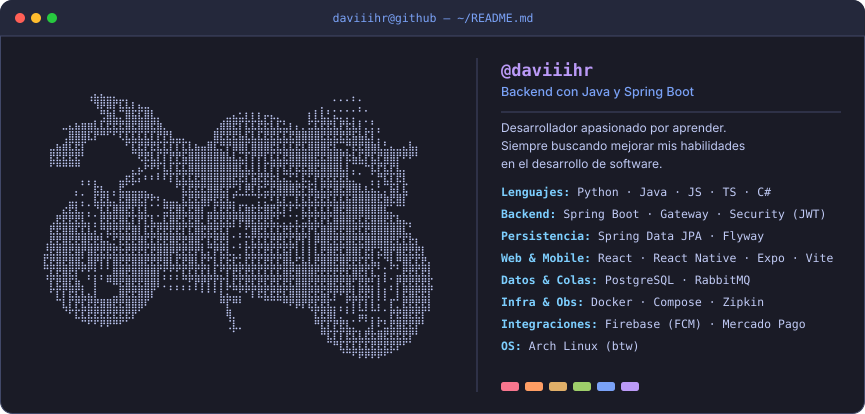

  

## 📊 Estadísticas de GitHub

  
  

 

  

 

  <!-- Requiere el workflow .github/workflows/snake.yml (ver instrucciones) -->
  <picture>
    <source media="(prefers-color-scheme: dark)" srcset="https://raw.githubusercontent.com/daviiihr/daviiihr/output/github-contribution-grid-snake-dark.svg">
    <source media="(prefers-color-scheme: light)" srcset="https://raw.githubusercontent.com/daviiihr/daviiihr/output/github-contribution-grid-snake.svg">
    
  </picture>

---

  
  

---

  <i>"Primero hazlo funcionar, luego hazlo bien, luego hazlo rápido."</i>

